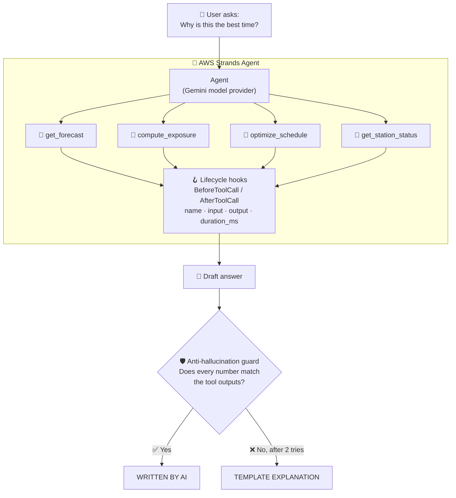
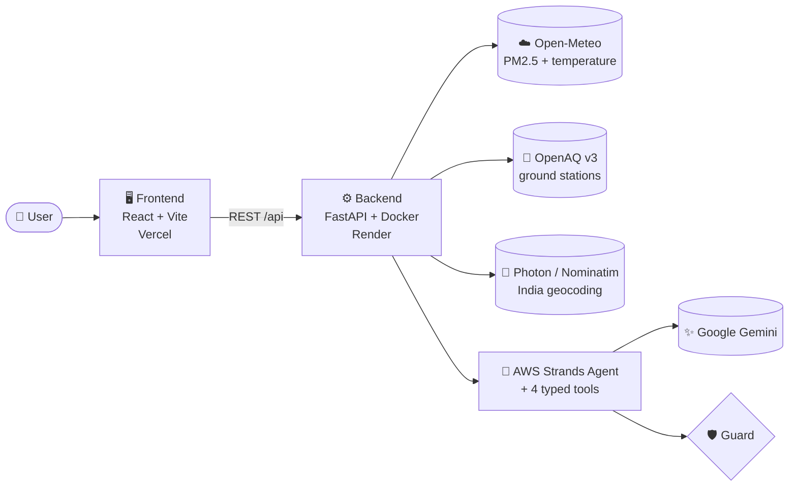

<div align="center">


### 🌬️ Find the cleanest time to step outside, and know exactly *why*.

**AirWindow tells people across India the best window for a run, walk or ride, using forecast PM2.5, heat, and how hard your lungs actually work. An AI agent built on the AWS Strands Agents SDK explains every recommendation, and every number it cites is verified.**

<br/>

[](https://airwindow-live.vercel.app)
[](https://strandsagents.com)
[](https://wemakedevs.org/aws/env)


[**▶ Try it live**](https://airwindow-live.vercel.app) · [**🐞 Report a bug**](https://github.com/Khushineware/AIRWINDOW/issues) · [**💡 Request a feature**](https://github.com/Khushineware/AIRWINDOW/issues)

</div>

---

## 🧭 Table of Contents

- [Why AirWindow?](#-why-airwindow)
- [AirWindow in 30 seconds](#-airwindow-in-30-seconds)
- [Features](#-features)
- [Powered by AWS Strands Agents](#-powered-by-aws-strands-agents)
- [How It Works](#-how-it-works)
- [Core Algorithms](#-core-algorithms)
- [Data Sources](#-data-sources)
- [Tech Stack](#-tech-stack)
- [Project Structure](#-project-structure)
- [Deployment](#-deployment)
- [Environment Variables](#-environment-variables)
- [Roadmap](#-roadmap)
- [Contributing](#-contributing)
- [Built for the Hackathon](#-built-for-the-hackathon)
- [Acknowledgements](#-acknowledgements)
- [Author](#-author)

---

## 💡 Why AirWindow?

Most air quality apps show one number: *"AQI is 180 right now."* That is useful, but it does not answer the question people actually have:

> **"When should I go for my run, walk, or ride so that I breathe in the least pollution?"**

Air quality changes hour by hour, and so does the weather. A person running breathes about twice as much air as a person walking, so the same air costs them more. AirWindow turns these facts into one clear recommendation: **the best time slot for your activity**, how much **less pollution** you inhale compared with your usual time, and a plain-language explanation of **why**.

It is built for runners, walkers, cyclists, and outdoor workers across India.

---

## ⚡ AirWindow in 30 seconds

| Step | What you do | What AirWindow does |
|:---:|---|---|
| **1** | Pick a place in India, an activity and a duration | Fetches the PM2.5 and temperature forecast for that spot |
| **2** | Choose when you could go | Corrects the forecast with real stations within 25 km, when available |
| **3** | Get your best window | Slides across the forecast in 15-minute steps and finds the lowest dose |
| **4** | Open **Why This Time** | A **Strands agent** runs its tools and explains the choice, with every number verified |

---

## ✨ Features

| | Feature | What it does |
|---|---|---|
| 🕐 | **Best-time finder** | Searches the forecast in 15-minute steps for the window with the lowest inhaled dose |
| 🫁 | **Dose, not just AQI** | Accounts for your activity (running, walking, cycling, sports) and how fast you breathe |
| 🌡️ | **Heat-aware** | Penalises slots above 35 °C so the "clean" hour is not also dangerously hot |
| 😷 | **Mask factor** | Models a consumer mask's effect on the dose you inhale |
| 📍 | **India-wide search** | Autocomplete restricted to India, plus GPS reverse geocoding |
| 📡 | **Ground-truth correction** | Calibrates the forecast with real monitoring stations within 25 km (OpenAQ) |
| 🤖 | **Strands-powered explanations** | An AWS Strands agent calls typed tools and explains the recommendation |
| 🛡️ | **Anti-hallucination guard** | AI answers are rejected if they contain any number the tools did not produce |
| 🔍 | **Live tool trace** | See which tools the agent ran, with inputs, outputs and timings |
| 🇮🇳 | **CPCB categories** | Uses India's official Good to Severe PM2.5 bands |

---

## 🤖 Powered by AWS Strands Agents

> [!IMPORTANT]
> **The AWS Strands Agents SDK is the brain of AirWindow.** Every explanation on the *Why This Time* screen comes from a Strands `Agent` that reasons with typed tools, records a real execution trace, and passes a verification guard before anything reaches the user.

AirWindow uses the open-source **[AWS Strands Agents SDK](https://strandsagents.com)** with a Google Gemini model provider. Instead of calling an LLM and hoping for the best, the agent is given **deterministic tools** and is held accountable for the numbers it quotes.

### 🧠 How the agent works



### 🔧 Four typed tools

Each tool is registered with the Strands `Agent` using `tool()` and a Zod input schema, so the model can only call them with valid arguments.

| Tool | What it does |
|---|---|
| `get_forecast` | Retrieves the CAMS PM2.5 and temperature forecast series for Indian coordinates |
| `compute_exposure` | Computes inhaled dose (µg) from the activity's ventilation rate and duration |
| `optimize_schedule` | Evaluates candidate time windows against a baseline and ranks them |
| `get_station_status` | Checks ground station freshness and returns a confidence rating |

### 🔍 A real execution trace, not a made-up timeline

Strands lifecycle hooks (`BeforeToolCallEvent` and `AfterToolCallEvent`) capture each tool call **as it happens**:

| Captured field | Example use |
|---|---|
| Tool name | Which tool the agent chose |
| Input parameters | The exact arguments it passed |
| Output payload | What the tool returned |
| `duration_ms` | How long the call really took |

This trace is returned by the API and displayed on the **Why This Time** screen, so users can see exactly how the answer was built.

### 🛡️ Trust, but verify

The guard extracts every number from the agent's answer and checks it against the tool outputs and plan data. If a number cannot be found, the answer is rejected. After two failed attempts, or if the LLM is unavailable, AirWindow falls back to a deterministic explanation and labels it honestly.

| Label | Meaning |
|---|---|
| ✅ `WRITTEN BY AI` | The answer passed verification |
| 📄 `TEMPLATE EXPLANATION` | Verification failed or the LLM was unavailable, so a rule-based explanation is shown |

---

## ⚙️ How It Works



**In one request:**

1. You choose a place, an activity, a duration and a search window.
2. The backend fetches the forecast and, if available, corrects it with nearby ground stations.
3. The optimizer slides a window across the forecast and finds the slot with the lowest weighted dose.
4. The Strands agent calls its tools and writes an explanation, and the guard verifies every number before you see it.

---

## 🧮 Core Algorithms

### 1. Time-series interpolation
Hourly forecasts are linearly interpolated into continuous **15-minute** points. Each point is classified using India's **CPCB** PM2.5 bands:

| Category | PM2.5 (µg/m³) |
|---|---|
| 🟢 Good | 0 – 30 |
| 🟡 Satisfactory | 31 – 60 |
| 🟠 Moderate | 61 – 90 |
| 🔴 Poor | 91 – 120 |
| 🟣 Very Poor | 121 – 250 |
| ⚫ Severe | > 250 |

### 2. Physiological dose

$$\text{Dose}\ (\mu g) = \sum \text{Effective PM2.5} \times \frac{\text{Breathing rate (L/min)}}{1000} \times 15\ \text{min}$$

| Activity | Ventilation rate |
|---|---|
| 🏃 Running | 40 L/min |
| 🏏 Sports | 35 L/min |
| 🚴 Cycling | 30 L/min |
| 🚶 Walking | 20 L/min |

A consumer mask applies a factor of **0.67** (33% particulate filtration).

### 3. Sliding-window optimizer
- Slides a window of your duration across the search period in 15-minute steps.
- Adds a **heat penalty of +2% per °C above 35 °C**.
- Minimises **Rank metric = Dose × (1 + Heat penalty)**.
- Compares against a baseline (your usual time, or the window median) to report the **% dose reduction**.
- Returns the best slot plus the **top 2 non-overlapping alternatives**.

### 4. Confidence and correction
Forecasts are adjusted with nearby OpenAQ station readings. If a key or station data is missing, AirWindow falls back to the uncorrected forecast and says so clearly.

---

## 🌐 Data Sources

| Source | Used for | Key needed |
|---|---|:---:|
| [Open-Meteo Air Quality](https://open-meteo.com/en/docs/air-quality-api) | CAMS PM2.5 forecast (hourly, Asia/Kolkata) | No |
| [Open-Meteo Weather](https://open-meteo.com/en/docs) | 2 m temperature for the heat penalty | No |
| [OpenAQ v3](https://docs.openaq.org) | Ground station observations within 25 km | Yes |
| [Photon (Komoot)](https://photon.komoot.io) | India-restricted autocomplete | No |
| [OpenStreetMap Nominatim](https://nominatim.org) | Geocoding fallback and reverse geocoding | No |
| [Google Gemini](https://ai.google.dev) | Language model behind the Strands agent | Yes |

---

## 🧰 Tech Stack

| Layer | Technology |
|---|---|
| **🤖 Agent framework** | **AWS Strands Agents SDK** |
| **Frontend** | React, Vite, TypeScript, Tailwind CSS |
| **Backend** | Python, FastAPI, Uvicorn, Pydantic |
| **LLM** | Google Gemini (`google-genai`) |
| **Container** | Docker (`python:3.12-slim`) |
| **Hosting** | Vercel (frontend), Render (backend) |

---

## 🗂️ Project Structure

```text
AIRWINDOW/
├── backend/                  # FastAPI service (deployed on Render)
│   ├── main.py               # App entry point, routes, CORS, /health
│   ├── src/
│   │   ├── agent/            # 🤖 Strands agent, tools, guard
│   │   └── services/         # OpenAQ, forecast, geocoding
│   ├── Dockerfile
│   └── requirements.txt
├── frontend/                 # React + Vite app (deployed on Vercel)
│   ├── src/
│   │   └── api/client.ts     # Reads VITE_API_BASE_URL
│   ├── vercel.json           # SPA rewrites
│   └── package.json
├── .env.example
└── README.md
```

---

## ☁️ Deployment

AirWindow runs as two independently deployed services, and every push to `main` redeploys both automatically.

| Service | Platform | Link |
|---|---|---|
| 🖥️ Frontend | Vercel | [airwindow-live.vercel.app](https://airwindow-live.vercel.app) |
| ⚙️ Backend API | Render (Docker) | [airwindow-api.onrender.com/health](https://airwindow-api.onrender.com/health) |

<details>
<summary><b>Backend settings (Render)</b></summary>

| Setting | Value |
|---|---|
| Runtime | Docker |
| Root directory | `backend` |
| Health check path | `/health` |
| Plan | Free |

</details>

<details>
<summary><b>Frontend settings (Vercel)</b></summary>

| Setting | Value |
|---|---|
| Framework preset | Vite |
| Root directory | `frontend` |
| Install command | `npm install --legacy-peer-deps` |
| Build command | `npm run build` |
| Output directory | `dist` |

</details>

> [!NOTE]
> The backend runs on Render's free tier, which sleeps when idle. The first request after a quiet period can take about a minute while it wakes up.

---

## 🔐 Environment Variables

| Variable | Where | Required | Description |
|---|---|:---:|---|
| `GEMINI_API_KEY` | Backend | ✅ | Key for the language model used by the Strands agent |
| `OPENAQ_API_KEY` | Backend | Optional | Enables ground-station correction |
| `ALLOWED_ORIGINS` | Backend | ✅ | Comma-separated CORS origins (the Vercel URL plus localhost) |
| `PORT` | Backend | Auto | Set by the host |
| `VITE_API_BASE_URL` | Frontend | ✅ | URL of the deployed backend, with no trailing `/` |

> [!WARNING]
> Never commit real keys. `.env` is listed in `.gitignore`, and `.env.example` shows the expected variables with dummy values.

---


## 🏆 Built for the Hackathon

<div align="center">

[](https://wemakedevs.org/aws/env)

</div>

AirWindow was created for the **[WeMakeDevs × AWS Environmental Hacks 2026](https://wemakedevs.org/aws/env)** hackathon.

**The idea:** air pollution is an environmental problem, but its health impact depends on *when* and *how* people are exposed. AirWindow turns open environmental data into a decision a person can act on today: a cleaner time to exercise, with a clear explanation they can trust.

**The AWS connection:** the **AWS Strands Agents SDK** is at the heart of the project. It orchestrates the agent, defines its typed tools, and records the real execution trace that powers the *Why This Time* screen.

| | |
|---|---|
| 🏁 **Hackathon** | [WeMakeDevs × AWS Environmental Hacks 2026](https://wemakedevs.org/aws/env) |
| 🤖 **AWS technology** | [AWS Strands Agents SDK](https://strandsagents.com) |
| 🌐 **Live demo** | [airwindow-live.vercel.app](https://airwindow-live.vercel.app) |
| 💻 **Source code** | [github.com/Khushineware/AIRWINDOW](https://github.com/Khushineware/AIRWINDOW) |

---

##  Acknowledgements

- **[WeMakeDevs](https://wemakedevs.org)** and **AWS** for organising Environmental Hacks 2026
- **[AWS Strands Agents SDK](https://strandsagents.com)** for agent orchestration, tools and lifecycle hooks
- **[Open-Meteo](https://open-meteo.com)**, **[OpenAQ](https://openaq.org)**, **[Photon](https://photon.komoot.io)** and **[OpenStreetMap](https://www.openstreetmap.org)** for open data
- **[Google Gemini](https://ai.google.dev)** for natural-language generation
- India's **[Central Pollution Control Board](https://cpcb.nic.in)** for the air quality standards

---

## 👤 Author

**Khushi Neware**
   [GitHub](https://github.com/Khushineware) · [LinkedIn](https://www.linkedin.com/in/khushi-neware-373937319)

---

<div align="center">

### If AirWindow helped you breathe a little easier, give it a ⭐

Built with 💙 for cleaner air across India 🇮🇳 · Powered by 🤖 **AWS Strands Agents**


</div>
